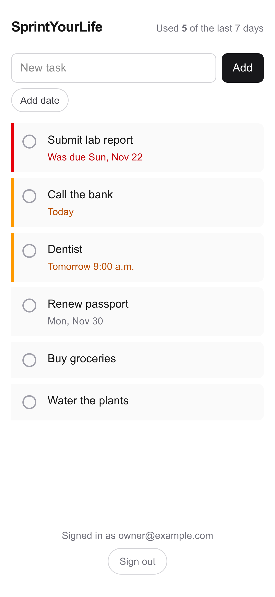
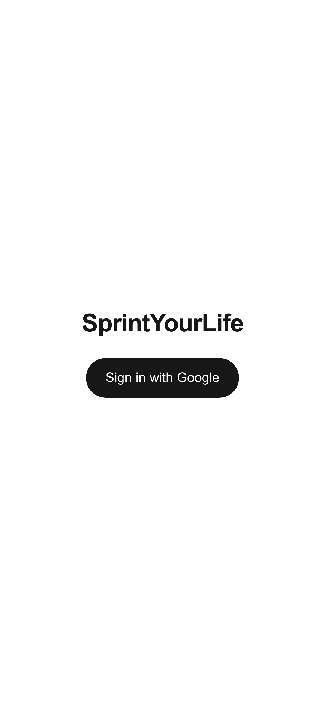
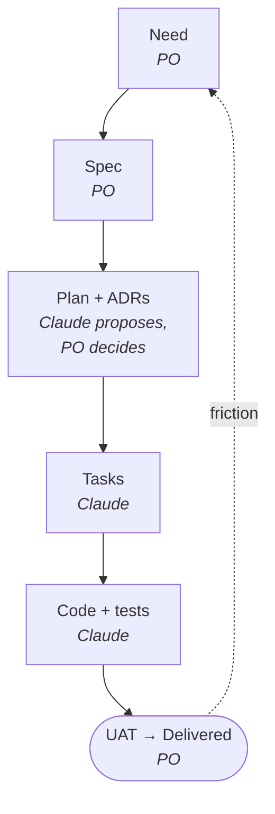

# SprintYourLife

[](https://github.com/AlexLeQc/SprintYourLife/actions/workflows/ci.yml)

**A personal web app that answers "what could I do right now?" in seconds**, and turns learning goals into short, measurable 2-week sprints. It's built to replace idle scrolling with *sidequests*: things I actually want to learn or try.

It's also a case study in **spec-driven development**. Every feature starts as a written spec with acceptance criteria, every significant choice is an Architecture Decision Record, and nothing is called done until it passes user acceptance testing on a real phone.

<p align="center">
  <picture>
    <source media="(prefers-color-scheme: dark)" srcset="docs/screenshots/tasks-phone-dark.png">
    
  </picture>
  &nbsp;&nbsp;
  <picture>
    <source media="(prefers-color-scheme: dark)" srcset="docs/screenshots/sign-in-dark.png">
    
  </picture>
</p>
<p align="center"><sub>Generated by <code>npm run screenshots</code> from fake data, in the same test harness as the end-to-end tests. They follow GitHub's light or dark theme.</sub></p>

## Status

In daily use since November 2026, installed on my phone's home screen.

| Spec | What it delivers | Status |
|---|---|---|
| [001 Foundation](specs/001-foundation/spec.md) | Installable app (PWA), Google sign-in restricted to an allowlist, 90-day session, usage days, CI | ✅ Delivered |
| [002 Tasks](specs/002-tasks/spec.md) | Add, edit, complete and delete tasks, with optional due date and time, urgency colours and undo | ✅ Delivered |
| [003 Portfolio-ready](specs/003-portfolio-ready/spec.md) | End-to-end browser tests and accessibility checks in CI; this README | 🚧 In progress |
| [004 Sidequest bank](specs/004-sidequest-bank/spec.md) | A Sidequests tab: capture sidequests in six categories (emoji + name), browse them alphabetically, edit, delete with undo; floating tab bar | ✅ Delivered |
| Next: F03 One-tap log | Mark that I did a sidequest, with an optional duration and note | [Backlog](specs/backlog.md) |

## Why

- In idle moments (in bed, between two activities), I picked up my phone and scrolled by default.
- My ideas for things to learn existed, scattered in notes, but they weren't in front of me **at the moment of choice**.
- Obligations worked because they had deadlines. So the app puts tasks and sidequests in one place: opening it for a task also shows something worth doing.

The full problem statement, success metrics and design principles are in the [vision](docs/vision.md).

## How it's built

The documentation is the source of truth. Code is written only from a validated spec, and when the code and the spec disagree, the spec wins (or gets changed on purpose, with a new version).



| Step | Artifact | What it holds |
|---|---|---|
| Spec | `spec.md` | User stories, Given/When/Then acceptance criteria, business rules, open questions with the PO's answers, UAT checklist |
| Plan | `plan.md` + ADRs | How it will be built, options with a recommendation, the PO's decisions, how each acceptance criterion will be verified |
| Tasks | `tasks.md` | Small steps with a "done when", ⛳ checkpoints where work stops for the PO, a progress log with evidence |
| UAT | spec's checklist | Run by the PO on production, on the real phone, before the spec is called Delivered |

| Role | Who | Responsibilities |
|---|---|---|
| Product Owner / Business Analyst | Alexis | Discovery, vision, backlog, specs and acceptance criteria, every decision, plan validation, UAT, declaring a spec Delivered |
| Implementation | [Claude Code](https://claude.com/claude-code), AI-assisted | Plans and options with a recommendation, tasks, code, tests, evidence for each check |

**About the AI part, plainly:** most of the code is written by an AI assistant. The work I show here is the analysis, the decisions and their reasons, the acceptance criteria, and the verification. An example of what that looks like in practice: when a library choice turned out to rest on outdated information, the decision wasn't edited away; a [new ADR](docs/decisions/0011-auth-library-better-auth.md) replaced it and says why.

**Rules every change follows:**

- Each spec moves through `Spec draft → Spec validated → Planned → In progress → In UAT → Delivered`, tracked in the [backlog](specs/backlog.md).
- Business rules live in a pure TypeScript module ([`src/domain/`](src/domain/)) with no framework or database, enforced by a lint rule. Each rule has unit tests named after its id (e.g. `BR-5`), so a requirement can be followed straight to its test.
- Every page and server action checks the session and the allowlist **before** reading anything private. A direct request with a fake cookie is part of each spec's verification.
- Branch → pull request → CI green → merge. Nothing goes to `main` directly.
- Public repository, private data: no real emails, secrets or user data in code, tests or screenshots.

## How quality is ensured

Four layers, each catching what the one before can't ([ADR-0015](docs/decisions/0015-testing-levels-unit-e2e-uat.md)):

| Layer | Tool | What it catches | When it runs |
|---|---|---|---|
| Unit tests | Vitest, 83 tests | Every business rule with its edge cases (midnight in Toronto, time zones, title length…), in milliseconds | Every pull request |
| End-to-end tests | Playwright, 23 flow tests, desktop and phone viewports | Each user flow in a real browser against a production build: add, list order and colours, done + undo, edit, delete + undo, access control. Named after the spec's AC ids | Every pull request that changes code |
| Accessibility | axe, 20 scans inside the end-to-end suite | WCAG 2.1 A + AA on every page and main state, light and dark. **Any violation fails the build** | With the end-to-end tests |
| UAT | The PO, on production, on the iPhone | The real device and Safari, the Google sign-in, "does it feel right", speed | Once per spec, before *Delivered* |

**The gate:** both CI checks are required on `main`, so nothing merges red. End-to-end tests run on a throwaway database in the CI job, with fake data only; they never touch production. A test that fails and then passes on retry is labelled **flaky** and the build stays red: a flaky test is treated as a bug, not retried away. Test order is checked too: the suite passes when shuffled (that check found and fixed a real leak between two tests).

**Not automated, on purpose:**

- **The Google sign-in round-trip.** Google blocks automated sign-ins (bot protection, two-factor), and faking Google would test the fake. Tests start from a real session created in the test database; the app's own session and allowlist checks still run. The sign-in page itself is tested, and the round-trip is checked in UAT.
- **Safari and the iPhone.** The tests use Chromium with a phone-sized screen; the real iPhone is checked in UAT.
- **Speed.** Timings on a CI machine say little about the phone; they're checked in UAT.

## Follow one requirement

One rule, from the spec to a green build. **BR-5: a task is overdue** when its date is before today, or, if it has a time, when that time has passed.

1. **Spec.** The rule is written in [spec 002 §4, business rules](specs/002-tasks/spec.md#4-business-rules--unit-tests-in-srcdomain), and the user-facing behaviour in [AC-2.3](specs/002-tasks/spec.md#us-2--see-open-tasks): an overdue task shows "Was due …" in red.
2. **Code.** [`isOverdue()`](src/domain/task.ts#L108) in the pure domain module: no framework, no database.
3. **Unit test.** [`isOverdue (BR-5)`](src/domain/task.test.ts#L130) covers the edges: overdue only once the day is over, not at the exact minute, a past day whatever the time, never without a date.
4. **End-to-end test.** [`spec 002 AC-2.1 to AC-2.6`](e2e/list.spec.ts#L12) seeds a task due yesterday and one due at midnight today, then checks in the browser that both read "Was due …" and are marked overdue, on a production build, with dates computed in Toronto time.
5. **CI.** Both run on every pull request; here is [a green run on `main`](https://github.com/AlexLeQc/SprintYourLife/actions/runs/45231303187) (83 unit tests; 43 end-to-end tests, including the 20 accessibility scans).

## Documentation

| Document | What it contains |
|---|---|
| [docs/vision.md](docs/vision.md) | Problem, users, goals and metrics, design principles, non-functional requirements |
| [specs/backlog.md](specs/backlog.md) | MoSCoW backlog, release plan, idea inbox |
| [specs/](specs/) | One folder per feature: `spec.md` (what), `plan.md` (how), `tasks.md` (steps + progress log with evidence) |
| [docs/architecture.md](docs/architecture.md) | Solution overview, data model, cross-cutting rules, NFR traceability |
| [docs/decisions/](docs/decisions/README.md) | Architecture Decision Records: context, options, decision, consequences |

A good place to start: [spec 002 Tasks](specs/002-tasks/spec.md), then its [plan](specs/002-tasks/plan.md) and [tasks with the progress log](specs/002-tasks/tasks.md).

## Stack

Next.js (React + Node, TypeScript) on Vercel · PostgreSQL on Neon · Drizzle ORM · Better Auth (Google sign-in + allowlist) · Vitest · Playwright + axe · GitHub Actions. Running cost: $0/month. The reasons for each choice are in the [ADRs](docs/decisions/README.md).

## Run locally

Requires Node 24+, and Docker for the end-to-end tests.

```bash
npm install
cp .env.example .env   # then fill in the values
npm run dev            # http://localhost:3000
```

| Command | What it does |
|---|---|
| `npm test` | Unit tests (business rules in `src/domain/`) |
| `npm run typecheck` | TypeScript check |
| `npm run lint` | ESLint, including the "pure domain" architecture rule |
| `npm run e2e:db` | Starts the throwaway test database (Docker) |
| `npm run e2e` | End-to-end and accessibility tests on a production build |
| `npm run e2e:shuffle` | The same, in random order |
| `npm run screenshots` | Regenerates the images in `docs/screenshots/` from fake data |
