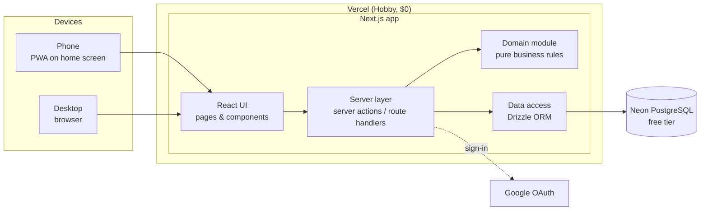
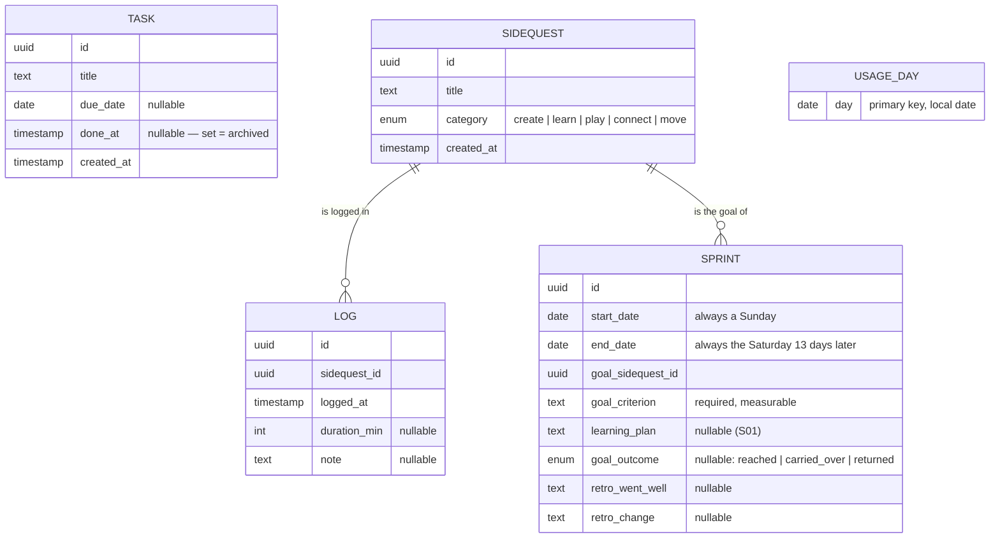

# Architecture — SprintYourLife

| | |
|---|---|
| **Status** | Accepted v1.1 — all decisions accepted (ADR-0001 to ADR-0011; 0008 superseded by 0011) |
| **Last updated** | 2026-11-16 |
| **Inputs** | [`vision.md`](vision.md) (NFRs, constraints) · [`../specs/backlog.md`](../specs/backlog.md) |
| **Decisions** | [`decisions/`](decisions/README.md) |

---

## 1. Architecture drivers

The architecture is shaped by a few requirements. Everything else is secondary.

| Driver | Source | Architectural consequence |
|---|---|---|
| $0 / month, forever | NFR-08 | Free tiers only; prefer providers with no "sleeping server" cold start |
| Opens in ~2 s from the home screen | NFR-01, NFR-03 | PWA; no backend that sleeps for 30+ s after inactivity |
| Only I can get in, repo is public | NFR-05, NFR-06 | Google sign-in + email allowlist; all secrets and the allowlist in environment variables, never in the repo |
| Online only | NFR-10 | No sync engine, no local database — a plain client/server web app |
| Solo, part-time, AI-assisted | Constraints | One repo, one deployment, one language (TypeScript) end to end |
| Business rules must be tested | Quality bar | Business rules live in a pure module with no framework or database dependency |

## 2. Solution overview

> Diagrams in this file use [Mermaid](https://mermaid.js.org/). They render on GitHub; in an editor, use a Mermaid-capable Markdown preview.

**One Next.js application (React + Node, TypeScript) on Vercel, with a PostgreSQL database on Neon.**

### Layers

| Layer | Responsibility | Knows about |
|---|---|---|
| **UI** (React) | Screens: "Now" (phone-first), Tasks, Bank, Sprint, Retro | Server layer only |
| **Server layer** | Checks the session, validates input, calls domain rules, reads/writes data | Domain, Data access, Auth |
| **Domain** | Business rules as plain TypeScript functions: sprint dates, "a goal needs a measurable criterion", what counts as a usage day, retro summary | **Nothing** — no framework, no database |
| **Data access** | SQL tables and queries via Drizzle | PostgreSQL |

**Why a separate domain module:** it's what makes the business rules testable in milliseconds without a database (ADR-0010), and it maps directly to the acceptance criteria in the specs. In an interview, this is the place to point to: *"each Given/When/Then in the spec has a test here."*

## 3. Data model (draft)

Final columns are decided in each feature's `plan.md`. This draft checks that the vision's glossary holds together.

Notes:
- **No `status` column on Sidequest.** "In the Bank" vs "current sprint goal" is *derived* from whether the active sprint points to it. One source of truth, no state to keep in sync.
- **Tasks are not linked to sprints** (vision §6). The sprint planning view simply queries tasks whose `due_date` falls inside the sprint dates.
- Auth tables (user, session, account, verification) are added by the auth library, Better Auth (ADR-0011).

## 4. Cross-cutting rules

| Rule | Why |
|---|---|
| **All "day" logic uses the `America/Toronto` time zone**, never the server's (UTC). Applies to usage days, sprint boundaries, due dates, "today". | Vercel servers run in UTC. Without this, a log made at 9 p.m. on Saturday would count for Sunday — in the *next* sprint. Classic bug, designed out from day one. |
| **Secrets and the allowlist live in environment variables** (Vercel + local `.env`, which is git-ignored). A committed `.env.example` lists the names with no values. | NFR-06: public repo. |
| **Every server entry point checks the session** before doing anything. | NFR-05: the UI hiding a button is not security. |
| **No real data in the repo** — not in tests, seeds, or screenshots. Test data is fake. | NFR-06. |

## 5. Environments and deployment

| Environment | Where | Database | Who |
|---|---|---|---|
| Local | `npm run dev` on my machine | Neon **dev branch** (a free copy of the schema, separate data) | Development |
| Production | Vercel, deployed automatically on push to `main` | Neon **`production` branch** (the project default) | Me, daily use |

- Pull requests run CI (ADR-0010). Vercel preview deployments may exist, but Google sign-in is only configured for production and localhost.
- Database schema changes are applied through versioned migration files committed in the repo.

## 6. NFR traceability

Every NFR from the vision has an answer here, so none gets lost.

| NFR | How it's addressed | Verified by |
|---|---|---|
| NFR-01 Installable | Web app manifest + icons; Next.js PWA setup | UAT on my phone (E01) |
| NFR-02 Stay signed in | Long-lived session (e.g. 90 days, renewed on use) | UAT (E02) |
| NFR-03 Fast (~2 s) | No sleeping backend; small "Now" page; DB cold start is sub-second-ish on Neon *(to measure)* | Timed UAT on mobile data (E01) |
| NFR-04 Responsive | Phone-first "Now" screen, desktop-first planning/retro | UAT on both devices |
| NFR-05 Private | Google sign-in + allowlist check at sign-in and on every request (ADR-0006) | Automated test + UAT with a second Google account |
| NFR-06 No data in repo | Env vars, `.gitignore`, fake test data | Code review |
| NFR-07 Durability | Provider-managed; risk accepted (ADR-0005); Neon Free has a **6-hour** restore window (checked 2026-11-16) | — |
| NFR-08 $0 | Vercel Hobby + Neon Free + Google OAuth (free) | Billing pages show $0 |
| NFR-09 English | ADR-0004 | Review |
| NFR-10 Online only | ADR-0003 | — |

## 7. Risks and things to verify

| # | Risk / unknown | Mitigation |
|---|---|---|
| AR1 | Free-tier limits change (they do, regularly). | Verify current Vercel Hobby and Neon Free terms during E01; the layered design keeps the database replaceable (any PostgreSQL works). |
| AR2 | Neon free compute sleeps when idle → first query after a pause is slower. | Measure during E01 against NFR-03. If too slow, revisit ADR-0007. |
| AR3 | Vercel Hobby is for non-commercial use. | This is a personal, non-commercial project. Fine. |
| AR4 | Next.js has a learning curve (server vs client components). | Claude implements; ADR and plan files explain the choices so I can defend them. |

## Revision history

| Version | Date | Change |
|---|---|---|
| 0.1 | 2026-11-16 | First proposal |
| 1.0 | 2026-11-16 | PO accepted ADR-0007 (option A), ADR-0008, ADR-0009 |
| 1.1 | 2026-11-16 | ADR-0011 (Better Auth) supersedes ADR-0008; Neon restore window verified |
